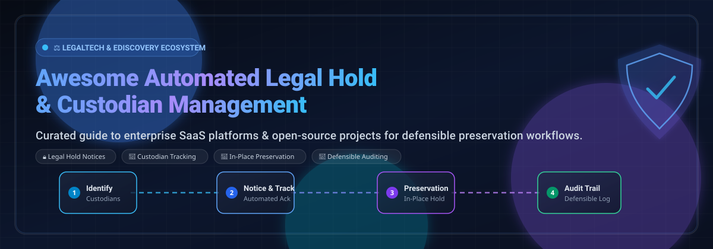
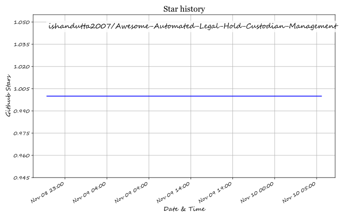

# ⚖️ Awesome Automated Legal Hold & Custodian Management

<p align="center">
  
</p>

<p align="center">
  <a href="https://github.com/ishandutta2007/Awesome-Awesome-Awesome"></a>
  <a href="https://discord.gg/jc4xtF58Ve"></a>
  <a href="https://github.com/ishandutta2007/Awesome-Automated-Legal-Hold-Custodian-Management/stargazers"></a>
  <a href="https://github.com/ishandutta2007/Awesome-Automated-Legal-Hold-Custodian-Management/network/members"></a>
  <a href="https://github.com/ishandutta2007/Awesome-Automated-Legal-Hold-Custodian-Management/blob/main/LICENSE"></a>
  <a href="https://github.com/ishandutta2007"></a>
</p>

---

## 📌 Executive Summary & Architecture

> Curated index of enterprise **SaaS platforms**, **open-source tools**, and **developer frameworks** dedicated to **Automated Legal Hold**, **Custodian Tracking**, **In-Place Data Preservation**, and **Defensible E-Discovery Workflows**.

Automated Legal Hold and Custodian Management platforms streamline the complete litigation hold lifecycle — from custodian identification via HR feeds (Workday, Azure AD), automated notice dispatch, escalation handling, and periodic re-attestation, to in-place preservation across enterprise sources (Microsoft 365, Google Workspace, Slack, Teams, Box, Zoom) and auditable matter releases.

```
┌──────────────────────┐     ┌───────────────────────┐     ┌────────────────────────┐
│ 1. Custodian Mapping │ ──> │ 2. Notice Automation  │ ──> │ 3. Data Preservation   │
│  - HRIS / SCIM Sync  │     │  - Auto Notifications │     │  - In-Place Freeze     │
│  - Departures Check  │     │  - Escalation Cadence │     │  - Tamper-Proof Audit  │
└──────────────────────┘     └───────────────────────┘     └────────────────────────┘
```

---

## 📑 Table of Contents
- [📊 Sector Overview & Market Dynamics](#-sector-overview--market-dynamics)
- [🏢 Enterprise SaaS Platforms](#-enterprise-saas-platforms)
- [💻 Open-Source GitHub Projects](#-open-source-github-projects)
- [🛠️ Architecture & Custom Pipeline Design](#️-architecture--custom-pipeline-design)
- [🤝 How to Contribute](#-how-to-contribute)
- [💖 Support & Sponsorship](#-support--sponsorship)
- [⚠️ Disclaimer](#️-disclaimer)
- [⭐ Star History](#-star-history)

---

## 📊 Sector Overview & Market Dynamics

The global legal hold and custodian management software market is estimated at **$1.4B to $1.8B**, projected to surpass **$3.5B–$4.2B by 2032** at an annual growth rate of **~10–12.7% CAGR**. Growth is heavily driven by cross-border regulatory scrutiny, expanding discovery scopes across unstructured collaboration apps (Slack, Teams, Confluence), and strict preservation defensibility standards under Federal Rules of Civil Procedure (FRCP Rule 37(e)). 

The industry remains **moderately fragmented**: sprawling enterprise hyperscalers (Microsoft Purview, OpenText) anchor high-volume data repositories, specialized litigation platforms (Relativity, Everlaw, DISCO) capture end-to-end review workflows, and agile preservation specialists (Druva, Logikcull, Onna) power modular API-first custodian tracking.

---

## 🏢 Enterprise SaaS Platforms

| Platform | Company Valuation / Revenue | Starting Pricing Tier | Free Tier Limits / Free Trial | Key Capabilities |
| :--- | :--- | :--- | :--- | :--- |
| **[Microsoft Purview Legal Hold](https://learn.microsoft.com/en-us/purview/)** | Valuation: ~$3.1T+ (Microsoft)<br>Revenue: ~$245B+ ARR | $12.00/user/mo (Purview Suite add-on over E3) or $60.00/user/mo (Full M365 E5) | 90-day free trial (includes 25 Purview Suite E5 trial licenses) | Native M365 preservation intercepting deletion across Exchange, SharePoint, OneDrive, and Teams with immutable holds [citation:10]. |
| **[TotalDiscovery](https://www.totaldiscovery.com/)** | Valuation: ~$6.2B (OpenText, parent)<br>Revenue: ~$5.25B ARR | $1,500/year (base cloud collection/hold tier; custom enterprise tiers available) | Free standalone Legal Hold & Data Profiler tier (unlimited basic hold tracking/reminders; paid tiers required for data collection/processing) | Cloud-based legal hold, custodian data collection, automated preservation, and ECA workflow solution [citation:13]. |
| **[Relativity Legal Hold](https://www.relativity.com/)** | Valuation: ~$3.6B (backed by ICONIQ)<br>Revenue: ~$235M–$320M ARR | $15.00/GB/month (RelativityOne data volume tier; custom annual contracts) | No self-serve free trial (14-to-30 day guided pilot / POC available upon qualified sales demo) | Integrated legal hold module inside RelativityOne with custodian interview questionnaires, escalations, and defensible audit reporting [citation:7]. |
| **[Druva Legal Hold Automation](https://www.druva.com/)** | Valuation: ~$2.0B (Series H)<br>Revenue: ~$200M+ ARR | $8.00/user/month (Enterprise tier) | 30-day free trial (full cloud data protection and legal hold workflow evaluation) | Cloud data protection platform with Legal Hold APIs for programmatic hold policies, custodian tracking, and WebDAV access [citation:4]. |
| **[Everlaw Legal Hold](https://www.everlaw.com/)** | Valuation: ~$2.0B (Series D)<br>Revenue: ~$80M–$90M ARR | $18.00/GB/month ($3.50/GB/mo archive tier via GSA; commercial hosting ~$18–$35/GB/mo with unlimited user seats) | No public self-serve free trial (14-day guided sandbox pilot via sales demo; free up to 50 GB for qualified "Everlaw for Good" pro-bono matters) | Scheduled renotifications, escalation notices, custodian acknowledgment tracking, and multi-cloud data preservation [citation:9]. |
| **[Logikcull Legal Hold](https://www.logikcull.com/)** | Valuation: >$1.0B (acquired by Reveal / K1)<br>Revenue: ~$40M–$60M ARR | $40.00/GB/month ($400/month minimum active storage; unlimited matters & user seats) | Free Tier available ("Logikcull Hold" offers free automated notice issuing, reminder scheduling, and release workflows; pay-as-you-go applies if ingesting data) | Microsoft 365 preserve-in-place integration, one-click mailbox/OneDrive holds, and multi-matter custodian management [citation:6]. |
| **[Exterro Legal Hold](https://www.exterro.com/)** | Valuation: >$1.0B (Unicorn recapitalization)<br>Revenue: ~$100M–$130M ARR | $49.00/user/month (or custom annual enterprise contract starting ~$10,000/year) | 30-day free trial / evaluation pilot for platform modules upon request; free FTK Imager standalone tool | Enterprise legal hold with automated escalation cadences, custodian questionnaire tracking, and unified eDiscovery oversight [citation:5]. |
| **[Casepoint Legal Hold](https://www.casepoint.com/)** | Valuation: Undisclosed (Acquired by Thoma Bravo, Jan 2025)<br>Revenue: ~$40M–$60M ARR | $1,200/month (modular legal hold platform base subscription; no per-user license fees) | No self-serve free trial (14-day guided trial sandbox available following customized enterprise consultation) | Unified legal hold module with automated communications, custodian tracking, and in-place preservation in a secure environment [citation:14]. |
| **[DISCO Legal Hold](https://www.csdisco.com/)** | Valuation: ~$350M–$400M Market Cap (NYSE: LAW)<br>Revenue: ~$171M TTM ARR | $500/month (base DISCO Hold flat tier; or all-inclusive per-GB processed data plan with unlimited users) | No self-serve free trial (14-day structured POC pilot upon request; free hosting up to 50 GB for approved pro-bono cases) | Cloud legal hold platform with one-click preserve-in-place across M365, Google Vault, Slack, Dropbox, and Box [citation:8]. |
| **[Onna Legal Hold](https://www.onna.com/)** | Valuation: ~$150M–$200M (Series B; $54M raised)<br>Revenue: ~$5M–$10M ARR | $1,000/month (starting tier based on 1 TB data volume; unlimited user licenses) | No self-serve free trial (custom 14-day guided proof-of-concept environment available upon request) | Legal hold and preservation API using JSON Logic queries for custodian/datasource targeting and workspace lifecycle management [citation:11]. |
| **[Zapproved Legal Hold Pro](https://www.zapproved.com/)** | Valuation: Subsumed under Exterro (Acquired 2023; ~$17M venture funding raised)<br>Revenue: ~$15M–$25M ARR | $4,500/year (ZDiscovery baseline subscription tier) | No self-serve free trial (14-to-30 day guided enterprise evaluation sandbox available upon request) | Automated custodian notifications, reminders, escalations, compliance questionnaires, and Office 365 hold automation [citation:12]. |

---

## 💻 Open-Source GitHub Projects

Curated open-source software, compliance toolkits, forensic acquisition tools, and retention engines for self-hosted legal hold workflows, sorted in descending order by GitHub_Stars:

1. 📂 **[ICIJ/extract](https://github.com/ICIJ/extract)** [](https://github.com/ICIJ/extract/stargazers)  
   *Cross-platform high-performance CLI utility for parallelized content extraction, document parsing, and file triage in investigative journalism and eDiscovery workflows.*

2. ⚖️ **[shmsoft/FreeEed](https://github.com/shmsoft/FreeEed)** [](https://github.com/shmsoft/FreeEed/stargazers)  
   *Open-source eDiscovery engine supporting automated data processing, PST/EML parsing, metadata indexing, deduplication, and staging for legal hold collections.*

3. 🔍 **[FreeDiscovery/FreeDiscovery](https://github.com/FreeDiscovery/FreeDiscovery)** [](https://github.com/FreeDiscovery/FreeDiscovery/stargazers)  
   *Open-source REST API service for eDiscovery analytics, semantic search, categorization, and custodian dataset exploration.*

4. 💬 **[mattermost/mattermost-plugin-legal-hold](https://github.com/mattermost/mattermost-plugin-legal-hold)** [](https://github.com/mattermost/mattermost-plugin-legal-hold/stargazers)  
   *Official Mattermost plugin enabling compliance officers to place specific channels, direct messages, and custodians on immutable legal hold to prevent message deletion.*

5. 📋 **[noamrazbuilds/legal-hold-manager](https://github.com/noamrazbuilds/legal-hold-manager)** [](https://github.com/noamrazbuilds/legal-hold-manager/stargazers)  
   *Litigation hold management application for creating, issuing, and tracking legal notices, tracking custodian acknowledgments, and logging defensible audit trails.*

6. 🛡️ **[wireapp/legalhold](https://github.com/wireapp/legalhold)** [](https://github.com/wireapp/legalhold/stargazers)  
   *Enterprise legal hold daemon for Wire secure collaboration, preventing message purged records and capturing compliance streams for selected accounts.*

7. ☁️ **[AlanHardesty/purview-ediscovery-export](https://github.com/AlanHardesty/purview-ediscovery-export)** [](https://github.com/AlanHardesty/purview-ediscovery-export/stargazers)  
   *Automated Microsoft Purview eDiscovery Premium legal hold export utility using Microsoft Graph API for programmatic custodian package extractions.*

8. 📦 **[zentrung/atlassian-evidence](https://github.com/zentrung/atlassian-evidence)** [](https://github.com/zentrung/atlassian-evidence/stargazers)  
   *Exports Jira, Confluence, and Bitbucket history into tamper-evident, SHA256-manifested JSONL for litigation holds, investigations, and regulatory audits.*

9. 📬 **[mailcellar/mailcellar](https://github.com/mailcellar/mailcellar)** [](https://github.com/mailcellar/mailcellar/stargazers)  
   *Tamper-evident, incremental email backup system with built-in legal hold protection and retention policy enforcement across Google Workspace and IMAP.*

10. 🔏 **[mizcausevic-dev/message-retention-guardian](https://github.com/mizcausevic-dev/message-retention-guardian)** [](https://github.com/mizcausevic-dev/message-retention-guardian/stargazers)  
    *Ruby microservice enforcing retention policies and litigation freeze protection with pressure scoring to halt automated purge workflows on held data.*

11. 🗄️ **[nimdassdev/OpenArchiver](https://github.com/nimdassdev/OpenArchiver)** [](https://github.com/nimdassdev/OpenArchiver/stargazers)  
    *Self-hosted email archiving and eDiscovery solution supporting Google Workspace, Microsoft 365, PST, and MBOX with immutable audit trails and hold capabilities.*

---

## 🛠️ Architecture & Custom Pipeline Design

For organizations designing a custom, vendor-neutral preservation stack:
* **Archival & Custodian Ingestion**: Deploy **OpenArchiver** or **mailcellar** to snapshot custodial mailboxes upon hold notice trigger.
* **Collaboration Preservation**: Use **mattermost-plugin-legal-hold** or **wireapp/legalhold** to freeze chat history.
* **Policy & Freeze Guard**: Integrate **message-retention-guardian** as an intermediate middleware layer to evaluate and lock retention expiration timers.
* **Storage & Indexing**: Couple PostgreSQL with Meilisearch or Elasticsearch for full-text custodian content search and cryptographic SHA-256 audit logs.

---

## 🤝 How to Contribute

Contributions are welcome! Help expand this list by submitting notable SaaS solutions or open-source legal preservation projects:

1. 🍴 Fork the repository.
2. 📝 Add or edit entries in `README.md` keeping the standard format:
   - For SaaS: Include Company Size, Starting Price, Free Tier/Trial Limits, and Capabilities.
   - For Open-Source: Include proper link, description, and Stars_Badge.
3. 🚀 Submit a Pull Request with a clear summary of your changes.

---

## 💖 Support & Sponsorship

If this curated ecosystem helps your legal ops, compliance engineering, or eDiscovery workflows, please consider supporting the project:

- ⭐ **Star the repository** to boost visibility for the legal tech community.
- 🍴 **Fork the repo** to add your company's integrations or contribute fixes.
- 📢 **Share with colleagues** in legal operations, infosec, and compliance.
- ☕ **Buy me a coffee**: Support ongoing open-source maintenance via the [GitHub Sponsor Dashboard](https://github.com/sponsors/ishandutta2007).

---

## ⚠️ Disclaimer

- This repository is a **community-curated index** provided for educational and informational purposes; it does not constitute formal legal counsel.
- Legal hold procedures must comply with jurisdiction-specific civil procedure rules (e.g., FRCP Rule 37(e), GDPR Article 17 exemptions). Consult certified legal counsel for litigation hold defensibility.

---

## ⭐ Star History

[](https://www.star-history.com/#ishandutta2007/Awesome-Automated-Legal-Hold-Custodian-Management&type=date&legend=top-left)

## ⭐ Star History

<a href="https://star-history.com/#ishandutta2007/Awesome-Automated-Legal-Hold-Custodian-Management&Timeline" align="center">
  <picture>
    <source media="(prefers-color-scheme: dark)" srcset="assets/ishandutta2007_Awesome-Automated-Legal-Hold-Custodian-Management_growth.svg">
    
  </picture>
</a>
